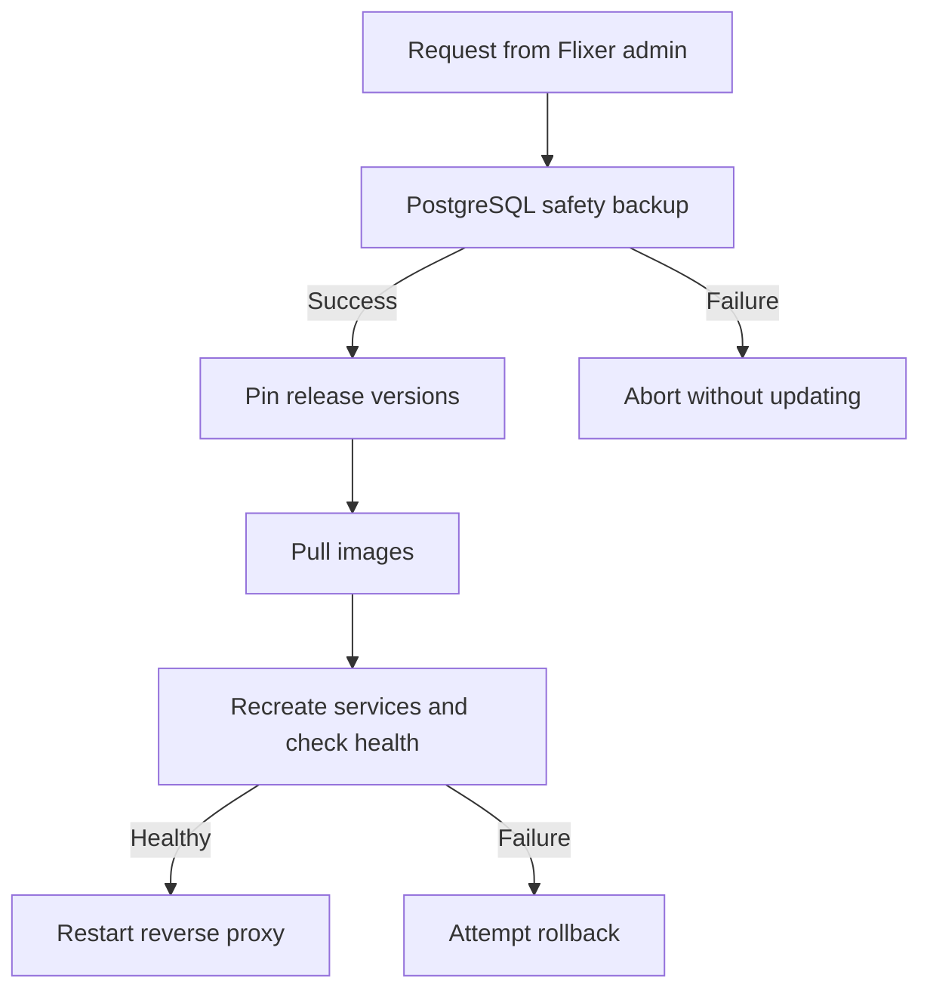

<div align="center">


# Flixer Updater

**Safer updates for your self-hosted stack.**

[](https://github.com/flixermedia/flixer-updater/stargazers) [](https://github.com/flixermedia/flixer-updater/issues)

[Flixer](https://github.com/flixermedia/flixer) · [Documentation](https://github.com/flixermedia/flixer-docs) · [Report an issue](https://github.com/flixermedia/flixer-updater/issues)

</div>

---

> [!WARNING]
> **Under active development.** Flixer components and integration contracts may change. Check current source and release notes before upgrading production installations.

> [!NOTE]
> **Role in Flixer:** The Go sidecar that orchestrates Docker Compose updates and restores. For an end-to-end deployment, start with the [Flixer backend repository](https://github.com/flixermedia/flixer).

## ✨ Features

- **Pre-update safety:** Take a PostgreSQL backup before changing versions.
- **Controlled rollout:** Pull and recreate streamer, indexer, web, then API with health checks.
- **Rollback:** Restore prior known release pins when a component fails.
- **Operational visibility:** Expose update status, progress and errors through an authenticated API.
- **Archive restore:** Restore Flixer `.flxbak` backups with validation and optional decryption.

## 🏗️ Architecture

Flixer separates application logic from its web UI, media indexing, media delivery, update management, plugins and documentation. **Flixer Updater** owns the following responsibility: the Go sidecar that orchestrates Docker Compose updates and restores.

For the full platform, the API coordinates services; the browser interacts with the backend and the streamer receives authorised playback requests. Components should be operated as part of the supported Flixer stack unless you are developing or testing them directly.

## 🚀 Getting started

### Recommended: use the Flixer stack
The updater is an **internal** Compose sidecar, not a public web application. Deploy it with Flixer's official stack so its secret volume, state volume, project mounts and Docker configuration agree.

### Go development

```bash
git clone https://github.com/flixermedia/flixer-updater.git
cd flixer-updater
go vet ./...
go test -race ./...
```

Do not expose port `8093` publicly. The updater needs Docker socket access (effectively host-root privileges), protected secrets and persistent state. Avoid configuring it outside a trusted deployment without reviewing the Compose mounts.

## 🏗️ Update sequence



Services update in the order **streamer → indexer → web → API**. Pinned releases are stored in `/state/versions.env`.

## ⚙️ Configuration

| Variable | Purpose |
| --- | --- |
| `PORT` | Internal HTTP listener; default `8093`. |
| `STREAM_TOKEN_SECRET_FILE` | Shared secret used to derive API bearer token. |
| `UPDATER_TOKEN` | Optional explicit token override. |
| `DATA_PATH` | Persistent data; default `/data`. |
| `STATE_DIR` | Version pins and state; default `/state`. |
| `HEALTH_TIMEOUT` | Per-component health timeout; default `3m`. |
| `BACKUP_PASSPHRASE_FILE` | Optional archive encryption passphrase. |

## 🔌 HTTP API

| Route | Function |
| --- | --- |
| `GET /health` | Public liveness within private network. |
| `GET /v1/status` | Current pins and operation status. |
| `POST /v1/update` | Start a pinned component update. |
| `POST /v1/backups/{name}/restore` | Validate and restore a Flixer archive. |

All `/v1` routes require bearer authentication. Restore validates archives and creates a safety backup before stopping affected services. The updater **does not update itself**; that image is managed separately. Rollback requires a known previous release, not an unversioned `latest` or `dev` image.

## 🔐 Operational security

Mounting `/var/run/docker.sock` and read/write configuration/secrets grants powerful host control. Keep the API internal, avoid publishing the port and restrict stack administration.

## 🧩 Flixer ecosystem

| Repository | Purpose |
| --- | --- |
| [Flixer](https://github.com/flixermedia/flixer) | The self-hosted backend API, authentication, libraries, and administration service. |
| [Flixer Web](https://github.com/flixermedia/flixer-web) | The Vue 3 application that powers browsing, sign-in, discovery, and playback interfaces. |
| [Flixer Streamer](https://github.com/flixermedia/flixer-streamer) | The Go service responsible for authorised media delivery and FFmpeg processing. |
| [Flixer Indexer](https://github.com/flixermedia/flixer-indexer) | The Go worker and API service for discovering, identifying, probing, and enriching media. |
| [Flixer Updater](https://github.com/flixermedia/flixer-updater) | The Go sidecar that orchestrates Docker Compose updates and restores. |
| [Flixer Plugins](https://github.com/flixermedia/flixer-plugins) | The official versioned catalogue of Flixer plugins and plugin schemas. |
| [Flixer Docs](https://github.com/flixermedia/flixer-docs) | The Docusaurus source for Flixer platform documentation. |

## 🤝 Contributing

Contributions, bug reports and documentation improvements are welcome. Open an [issue](https://github.com/flixermedia/flixer-updater/issues) with reproduction steps or a focused proposal, then submit a pull request against the repository. Keep configuration, examples and documentation aligned with implemented code. For backend contributions, also see the [main contribution guidelines](https://github.com/flixermedia/flixer/blob/main/CONTRIBUTING.md).

## 📄 Licence

Check this repository's [`LICENSE`](LICENSE) file, if present, for the authoritative licensing terms. The [main Flixer backend](https://github.com/flixermedia/flixer/blob/main/LICENSE) uses MIT; licensing for separate components should be verified individually before redistribution.

---

<div align="center">

**Your media. Your server. Your rules.**

Made for the [Flixer](https://github.com/flixermedia) ecosystem.

</div>
